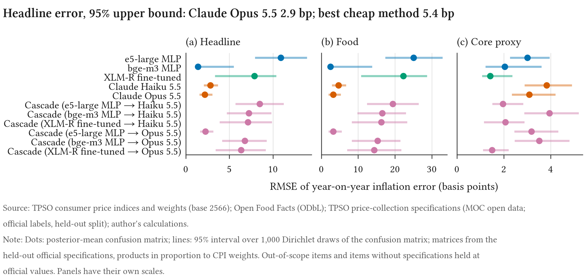

<p align="center"></p>

<h1 align="center">cpilens</h1>

[](https://github.com/thanatchon36/cpilens/actions/workflows/ci.yml)
[](LICENSE)
[](data/SOURCES.md)
[](https://github.com/thanatchon36/cpilens/releases/tag/v0.1.1)
[](https://doi.org/10.5281/zenodo.23686886)

📄 **Read the paper:** **[on the web](https://thanatchon36.github.io/cpilens/paper/)** ·
**[PDF](paper/main.pdf)** ·
📝 **[Policy brief (PDF)](paper/brief.pdf)** ·
📊 **[Figures](figures/out/)** ·
📚 **[Documentation](https://thanatchon36.github.io/cpilens/)** ·
🧾 **[Data sources](data/SOURCES.md)**

**How much does product classification cost in basis points?** Multilingual classification of
Thai product text into the items of the Thai consumer price index, and what each method's
errors do to measured inflation. A statistical office or
central bank that builds a price index from web or scanner data must first assign every product
to an item of the official basket. This repository measures that step for a non-English market
with public data only: how well frozen multilingual embeddings, a fine-tuned encoder, LLM
prompting and a cheap-then-expensive cascade classify Thai product names; what each costs; how
many official labels the embedding classifiers need; and, the centrepiece, how many basis points
of headline, food and core inflation each method's confusion matrix would add or remove.

<!-- results:start (generated by `cpilens report`) -->
<p align="center"></p>

**In five sentences.** Using public data only, we classify Thai product text into the items of
the Thai CPI and measure what each method's errors would do to measured inflation, scoring on
3,910 held-out official price-collection specifications weighted by CPI expenditure.
Transfer from non-Thai products alone gets an e5-large classifier to 60.3%
of the evaluated CPI weight, and all 24,456 official labels raise it to 68.8%.
Claude Opus 5.5 reaches 97.9% and Claude Haiku 5.5 95.4%, and a cascade from e5-large to
Claude Opus 5.5 scores 97.8% at 27% of its cost on the held-out
list. With Claude Opus 5.5's
confusion matrix, headline year-on-year inflation would be misstated by
1.9 basis points (RMSE; at most 3.7 at the
upper end of a 95% interval that allows errors to cluster), against
1.9 to 10.4 for cheaper classifiers trained on all
labels. Accuracy does not rank
methods by this error, and most of the LLMs' remaining errors trace to gaps in our
description of the official basket, not to misreadings of Thai.

*Numbers in this block are filled in from `results/` by `cpilens report` (template:
`docs/readme_results.md`). Total LLM spend for the study: USD 14.72.*
<!-- results:end -->

> **Status (28 October 2026): v0.1.1 released**, with the paper and the brief attached to the
> [release](https://github.com/thanatchon36/cpilens/releases/tag/v0.1.1). Every number in the paper, the brief and this README is generated by code from
> `results/` (`scripts/check_numbers.py` fails the build on a hand-typed number). Design
> decisions: [`docs/decisions.md`](docs/decisions.md).

## What is in the repository

| Part | Where | What it does |
|---|---|---|
| Taxonomy | `taxonomy/`, `cpilens/taxonomy/` | The in-scope items of the Thai CPI (base 2566) with their COICOP 2018 classes; a crosswalk from Open Food Facts category tags; official aggregate weights and *estimated* item weights (equal split and NNLS inside each published weight cell) |
| Data | `cpilens/data/` | Downloads with checksums: Open Food Facts and Open Beauty Facts product dumps, TPSO monthly CPI indices (open API), TPSO weight tables, Ministry of Commerce price-collection specifications |
| Classifiers | `cpilens/embed/`, `cpilens/classify/` | Frozen multilingual embeddings (multilingual-e5-large, bge-m3) with k-NN, logistic regression and MLP; fine-tuned XLM-R; Claude Haiku 5.5 and Claude Opus 5.5 prompting with cached responses and a cost log; cascades with dev-chosen thresholds |
| Reference set | `cpilens/evaluate/gold.py` | Held-out official specifications: whole sub-items are held out inside every item, and the out-of-scope part is a fixed sample carried with design weights. A labelling app for a hand-labelled product sample (`cpilens/label/`) exists but is not used in this version |
| Evaluation | `cpilens/evaluate/` | CPI-expenditure-weighted accuracy, accuracy–coverage and cost–accuracy frontiers, stratified bootstrap intervals, paired comparisons |
| Inflation simulator | `cpilens/econ/` | What a confusion matrix does to measured headline, food and core inflation, in basis points, under a stated product universe, with a posterior over the confusion matrix and a decomposition by confused pair |
| Figures and paper | `figures/`, `paper/`, `cpilens/report/` | Twelve figures in one house style; a LaTeX paper whose every number comes from `paper/numbers.tex`, written by `cpilens report` |

## Research questions

1. **Cross-lingual transfer.** How well do classifiers trained on non-Thai product text transfer
   to Thai, and how does accuracy grow with official Thai labels (a learning curve)?
2. **Frontiers.** For each method and the cascade, the expenditure-weighted accuracy–coverage
   and cost–accuracy frontiers.
3. **Materiality.** How many basis points of monthly and annual inflation does each method's
   confusion matrix cost, and which confusions matter?

A fourth question in the original design, the human label ceiling, is not measured in this
version: no product sample was hand-labelled, and the evaluation uses the statistical office's
own labels instead (see the paper's Limitations).

## Reproduce

One command, `make all`, runs every step below in order. Step by step:

```bash
uv sync --group ml                        # Python 3.11; the ml group (torch) is only for `make models`
make data                                 # public sources (checksums verified), corpus, splits
make models eval econ figures             # classifiers, evaluation on the reference set, simulator, figures
make paper                                # numbers.tex from results/, typed-number check, PDF via tectonic
make check                                # ruff, mypy, pytest with a coverage gate, typed-number check
```

LLM calls need `ANTHROPIC_API_KEY` in a gitignored `.env`. Every response is cached in
`.cache/llm/` and replayed, every billed call is logged to `results/llm_costs.csv`, and spend is
capped in code. `results/run_manifest.json` records package versions and model revisions. The
models' predictions (`results/preds/`) and the reference set (`data/reference_set.csv`) are
committed, so

```bash
uv sync && uv run cpilens fetch-tpso && make eval econ figures paper
```

rebuilds every number in the paper without the ml group, a GPU, an API call or the Open Food
Facts dump. `fetch-tpso` reads TPSO's live index API (raw files are not redistributed); `make
data` downloads the other sources and checks them against recorded checksums, so if an
upstream file has changed since this release the build stops instead of quietly using other
data.

## Data and licences

Code: MIT ([`LICENSE`](LICENSE)). Data derived from Open Food Facts (corpus and weak
labels): Open Database License (ODbL) 1.0, © Open Food Facts contributors. Thai CPI indices and
weights: Trade Policy and Strategy Office, Ministry of Commerce; price-collection specifications:
Ministry of Commerce open data. Every source, with URL, retrieval date, licence and checksum, is
in [`data/SOURCES.md`](data/SOURCES.md); see also the [data card](docs/data_card.md) and the
[model card](docs/model_card.md). No retailer website was scraped.

The BIS Innovation Hub's Project Spectrum is the closest prior work. Its results are cited from
the public report ([`docs/spectrum_notes.md`](docs/spectrum_notes.md)) and are not directly
comparable to ours. This is independent work, not a BIS, ECB or Bank of Thailand publication.

## Citation

See [`CITATION.cff`](CITATION.cff). Every release is archived on Zenodo; the concept DOI
[10.5281/zenodo.23686886](https://doi.org/10.5281/zenodo.23686886) always resolves to the latest
version.

## Disclaimer

*The views expressed are the author's own and do not necessarily reflect those of the Bank of
Thailand. This work uses only publicly available data.*
