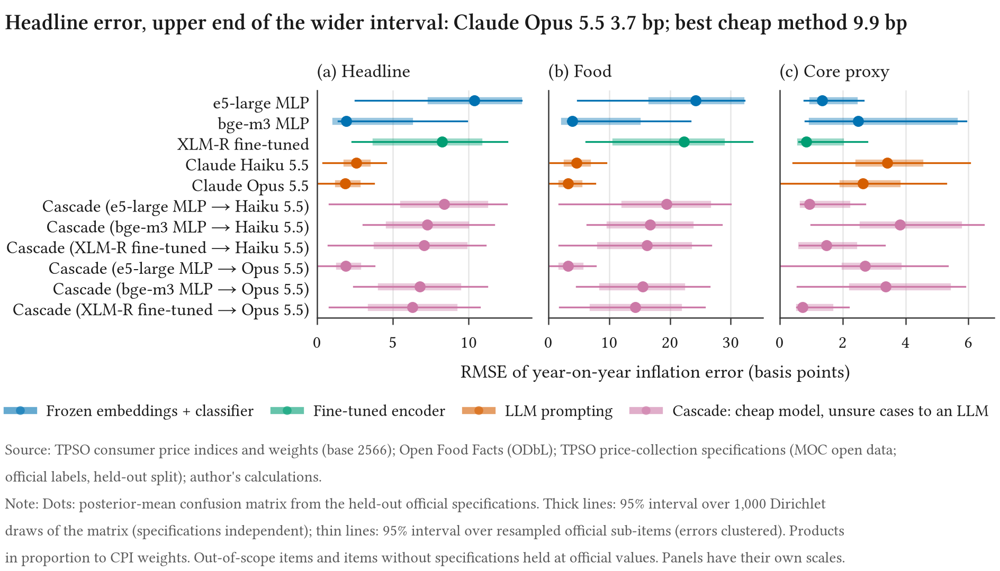

# cpilens

**How much does product classification cost in basis points?**

A statistical office or central bank that builds a price index from web or scanner data must
first assign every product to an item of the official basket. Done by hand, that step does not
scale; done by a model, it introduces an error. The literature reports that error as accuracy.
A central bank needs to know how far measured inflation would move.

cpilens answers that question for one language and one index, with public data only. It
classifies Thai product text into the items of the Thai consumer price index with frozen
multilingual embeddings, a fine-tuned encoder, LLM prompting and a cheap-then-expensive
cascade; scores each method on the statistical office's own held-out price-collection
specifications, weighted by CPI expenditure; and passes each method's confusion matrix through
a simulator of the Thai CPI that returns the error in basis points of measured headline, food
and core inflation.

[Read the paper](paper/index.html){ .md-button .md-button--primary }
[Download the PDF](paper/paper.pdf){ .md-button }
[Policy brief (2 pages)](paper/brief.pdf){ .md-button }



*The figure the paper leads with: what each method's classification errors would do to measured
inflation. Generated by code from `results/`.*

## Start here

| If you want to | Go to |
|---|---|
| Read the study | [the paper](paper/index.html), or the [two-page brief](paper/brief.pdf) for the policy argument |
| Know what the data are and what they are not | [Data card](data_card.md) |
| Know what the classifiers are and what they are for | [Model card](model_card.md) |
| See why the study is built the way it is | [Design decisions](decisions.md) |
| Check a citation or a claim about Project Spectrum | [References](references_verified.md), [Spectrum notes](spectrum_notes.md) |
| Run it yourself | [the repository](https://github.com/thanatchon36/cpilens#reproduce) |

## Reproduce

With the committed predictions and reference set, every number in the paper rebuilds without a
GPU, an API call or the Open Food Facts dump:

```bash
git clone https://github.com/thanatchon36/cpilens && cd cpilens
uv sync && uv run cpilens fetch-tpso
make eval econ figures paper
```

`make all` runs the whole pipeline from the public sources. Every number in the paper, the
brief and the README is generated by code from `results/`, and a check in continuous
integration fails the build on a number typed by hand.

## Citation

Every release is archived on Zenodo; the concept DOI
[10.5281/zenodo.23686886](https://doi.org/10.5281/zenodo.23686886) always resolves to the
latest version. See
[`CITATION.cff`](https://github.com/thanatchon36/cpilens/blob/main/CITATION.cff).

This is independent work, not a BIS, ECB or Bank of Thailand publication. Its numbers are not
directly comparable with those of the BIS Innovation Hub's Project Spectrum, the closest prior
work: the taxonomy, language, product universe and labels all differ.
